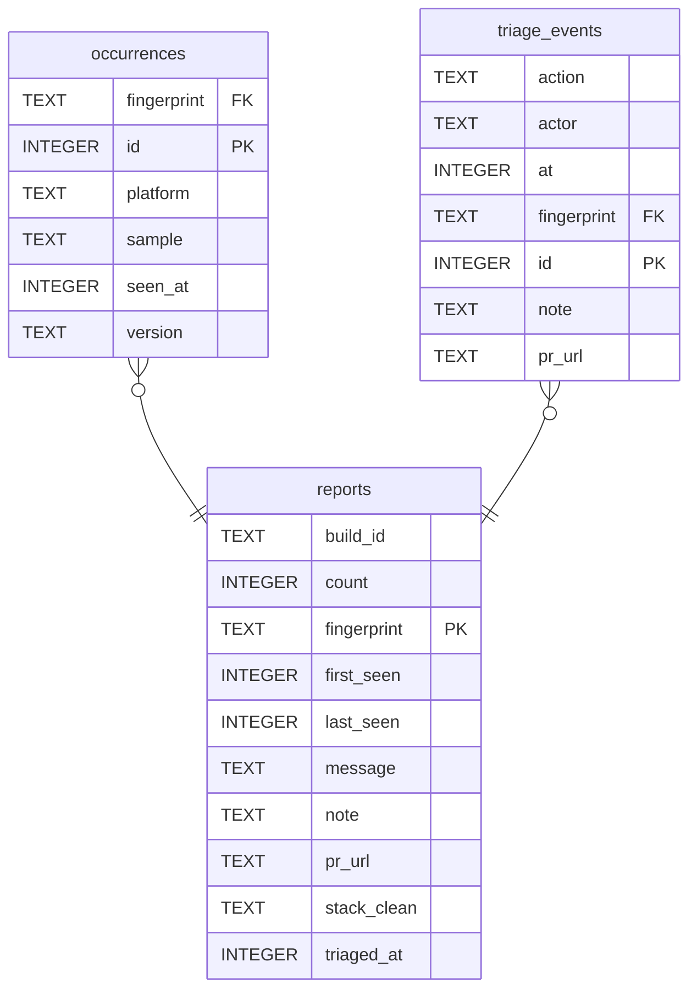

# delegator-report

Crash/error reporting Worker for the ZingoLabs Delegator app (Zcash Crosslink featurenet).
Prototype-grade. Nitro (TypeScript) + Cloudflare Workers + D1. No third-party services.

## Layout

```
nitro.config.ts            # preset: cloudflare-module, srcDir: server
wrangler.toml              # Worker name, D1 binding "DB", nodejs_compat
schema.sql                 # D1 tables: reports, occurrences, ratelimit, triage_events
seed.sql                   # example rows for local dev
server/routes/report.post.ts   # POST /report
server/routes/view.get.ts      # GET  /view?key=...      full rows (JSON)
server/routes/queue.get.ts     # GET  /queue?key=...     minimal safe rows for agents (JSON)
server/routes/triage.post.ts   # POST /triage?key=...    mark a fingerprint triaged
server/routes/feed.xml.get.ts  # GET  /feed.xml?key=...  Atom feed
server/routes/r/[fingerprint].get.tsx  # GET /r/<fp>?key=...  HTML page, feed entry link target
server/components/ui/          # shadcn-style preact components (static only); design system
server/components/             # layout + page components
server/utils/html.ts           # renderToStaticMarkup helper
src/app.css                    # Tailwind v4 entry + design tokens -> public/app.css (built)
server/utils/env.ts            # bindings, sha256, stack normalize/clean, key check, ETag
server/utils/reports.ts        # shared filter + query
.dev.vars.example          # local secrets template (copy to .dev.vars)
```

## Setup

```sh
pnpm install

# 1. Create the D1 database and paste the returned database_id into wrangler.toml
pnpm wrangler d1 create delegator-report

# 2. Apply the schema (remote). Idempotent; re-run after schema changes.
pnpm db:init

# 3. Set the three tokens (long random values)
openssl rand -hex 32 | pnpm wrangler secret put REPORT_TOKEN   # shipped in the app; create-only
openssl rand -hex 32 | pnpm wrangler secret put READ_TOKEN     # feed, page, JSON
openssl rand -hex 32 | pnpm wrangler secret put WRITE_TOKEN    # triage

# 4. Deploy
pnpm deploy
```

## Local development

```sh
cp .dev.vars.example .dev.vars   # dev values for the three tokens
pnpm db:init:local            # apply schema to the local D1 (.wrangler/state)
pnpm db:seed:local            # optional: load example rows from seed.sql
pnpm dev                      # nitro dev with wrangler bindings proxy, http://localhost:3000
```

Then open `http://localhost:3000/view?key=dev-token-change-me`, or post a report:

```sh
curl -X POST localhost:3000/report -H 'x-report-token: dev-report-token' -H 'content-type: application/json' \
  -d '{"buildId":"a1b2c3d4","version":"0.4.2","platform":"ios","stack":"Error: boom\n  at foo (app.js:1:2)","message":"boom","breadcrumbs":[]}'
```

To start over: `pnpm db:reset:local`.

`pnpm preview` builds nothing; it runs `wrangler dev` against the last `pnpm build` output
(the closest thing to the real Worker runtime). Run `pnpm build` first.

Other scripts: `build`, `typecheck`, `lint`, `lint:fix`, `fmt`, `fmt:check`, `check` (all three),
`db:reset:local` (wipe local D1, re-apply schema and seed), `erd` (Mermaid ER diagram),
`schema:snapshot` / `schema:list` / `schema:diff` / `schema:show` (schema history, below).

Tooling: pnpm (pinned via `packageManager`), oxlint (`.oxlintrc.json`), oxfmt (`.oxfmtrc.json`).
Run `pnpm check` before opening a PR.

Schema changes: nothing is deployed yet, so edit `schema.sql` in place and run
`pnpm db:reset:local`. Start a `migrations/` folder with the first deploy.

### Schema history

`scripts/schema.ts` reads the schema that is actually applied to the local D1 (from
`sqlite_master`), normalizes it, and keeps numbered snapshots in `docs/schema/`.

```sh
pnpm schema:snapshot [label]   # write docs/schema/NNNN-YYYYMMDD[-label].sql if the schema changed
pnpm schema:list               # snapshots with hash and object counts, plus the live state
pnpm schema:diff               # latest snapshot vs live
pnpm schema:diff 2 3           # between two snapshots; "live" is also a valid ref
pnpm schema:show [n|live]      # print one
```

Take a snapshot after each schema change you want to remember. Once deployed, the diff between
the deployed snapshot and the next one is the starting point for a migration file.

## Schema

Generated from the local D1 with `pnpm erd` (needs [mermerd](https://github.com/KarnerTh/mermerd):
`go install github.com/KarnerTh/mermerd@latest`). Re-run after changing `schema.sql` and paste
the output here and into `docs/erd.mmd`. `ratelimit` is omitted; it is a counter, not data.



## Roles and tokens

| token          | who holds it            | grants                                             |
| -------------- | ----------------------- | -------------------------------------------------- |
| `REPORT_TOKEN` | the app (extractable)   | `POST /report`: create a fingerprint or bump count |
| `READ_TOKEN`   | humans, readers, agents | `/view`, `/queue`, `/feed.xml`, `/r/<fp>`          |
| `WRITE_TOKEN`  | admins, the agent loop  | `POST /triage`                                     |

The report token sits inside a public app, so treat it as a noise filter and a rotation handle,
not a secret. The real guarantees on the create path are structural: a report can only insert a
row or increment its count, the first payload (`firstSample`) is never overwritten, and the
rate limit applies. Reporters cannot read anything and cannot touch triage.

The read token ends up stored in feed readers and hosted services. Rotate it if it leaks; it
cannot modify data. The write token should stay with admins and the agent runner.

## Endpoints

### `POST /report`

Header: `x-report-token: <REPORT_TOKEN>`. Missing or wrong token: the report is dropped.

Fire-and-forget. **Always responds `204 No Content`**, including on a bad token, malformed bodies,
rate-limit rejections, and internal errors. Clients must not retry or surface failures.

Body (JSON):

```json
{
  "buildId": "a1b2c3d4",
  "version": "0.4.2",
  "platform": "ios",
  "stack": "Error: boom\n  at foo (app.js:1:2)\n  at bar (app.js:3:4)",
  "message": "boom",
  "breadcrumbs": ["opened wallet", "tap send"]
}
```

| field       | required | notes                                              |
| ----------- | -------- | -------------------------------------------------- |
| buildId     | yes      | clipped to 128 chars; part of the fingerprint      |
| stack       | yes      | clipped to 16k chars; normalized then hashed       |
| version     | no       | default `"unknown"`                                |
| platform    | no       | default `"unknown"`                                |
| message     | no       | clipped to 2k chars                                |
| breadcrumbs | no       | array, last 50 kept, stored opaquely in the sample |

Behaviour:

- `fingerprint = sha256(buildId + "\n" + normalize(stack))`, where normalize trims every line,
  collapses runs of whitespace, and drops blank lines.
- `reports` holds one row per fingerprint: `count`, `first_seen`, `last_seen`, `build_id`,
  `message` and `stack_clean` from the first report, and triage state.
- `occurrences` holds one row per received report: `seen_at`, `version`, `platform`, and the
  full JSON `sample`. The first occurrence is kept forever; after that only the newest 20.
- Rate limit: 60 reports per client IP per hour. Excess reports are dropped silently. This
  moves to a per-device key once reports are signed.

Example:

```sh
curl -X POST https://delegator-report.<account>.workers.dev/report \
  -H 'x-report-token: <REPORT_TOKEN>' -H 'content-type: application/json' \
  -d '{"buildId":"a1b2c3d4","version":"0.4.2","platform":"ios","stack":"Error: boom\n  at foo (app.js:1:2)","message":"boom","breadcrumbs":[]}'
```

### `GET /view?key=<READ_TOKEN>`

JSON array of fingerprint rows sorted by `count DESC, lastSeen DESC`. Any missing or wrong key
returns `403`. There is no other auth; keep the token long and private.

Query params (all optional, shared by `/view`, `/queue`, `/feed.xml`):

| param       | meaning                                                       |
| ----------- | ------------------------------------------------------------- |
| `since`     | unix ms; only rows with `lastSeen > since`                    |
| `limit`     | max rows, default 500 (`/queue` 100, `/feed.xml` 50), cap 500 |
| `buildId`   | exact match                                                   |
| `untriaged` | `1` to return only rows with no `triagedAt`                   |

Sends a weak `ETag`; send it back as `If-None-Match` to get `304`.

```json
[
  {
    "fingerprint": "b5a09a85c5ee...",
    "count": 42,
    "firstSeen": 1761800000000,
    "lastSeen": 1761900000000,
    "buildId": "a1b2c3d4",
    "message": "TypeError: cannot read property balance of undefined",
    "stackClean": "at WalletView (wallet.tsx:88:12)\nat render (react.js:1:1)",
    "platforms": { "ios": 2, "android": 1 },
    "versions": { "0.4.2": 2, "0.4.3-dev": 1 },
    "firstSample": { "buildId": "a1b2c3d4", "stack": "...", "message": "...", "breadcrumbs": [] },
    "latestSample": { "buildId": "a1b2c3d4", "stack": "...", "message": "...", "breadcrumbs": [] },
    "triagedAt": null,
    "prUrl": null,
    "note": null
  }
]
```

`platforms` and `versions` count retained occurrences (first + newest 20), not all `count`
reports. `message`, `firstSample`, and `latestSample` are **untrusted client input**;
`firstSample` never changes, `latestSample` moves with each new report. Do not feed them to an agent as instructions. `stackClean` keeps only frame-like lines.

### `GET /queue?key=<READ_TOKEN>`

Same params. Defaults to `untriaged=1` and `limit=100`. Returns the minimal safe shape for agents:
`fingerprint, count, firstSeen, lastSeen, buildId, stackClean, platforms, versions, triagedAt, prUrl`.
No free-text fields.

### `POST /triage?key=<WRITE_TOKEN>`

Body: `{ "fingerprint": "<64-hex>", "actor"?: string, "prUrl"?: string, "note"?: string, "reset"?: true }`.
Sets `triagedAt = now` and stores `prUrl`/`note` on the row. `reset: true` clears them.
Every call also appends a row to `triage_events` (append-only history: time, action, actor,
prUrl, note). `actor` is free text such as `"dorian"` or `"agent-v1"`, default `"unknown"`.
`400` bad fingerprint, `404` unknown, `200 { ok, fingerprint, triagedAt, actor }`.

The history shows as a "Triage log" section on the page and in each feed entry.

### `GET /feed.xml?key=<READ_TOKEN>`

Atom feed, newest `firstSeen` first, default 50 entries. Entry id is the fingerprint, so a reader
notifies once per new crash type. Entry content is the same component as the page, so both
carry identical information. Sends `application/atom+xml`, `cache-control: max-age=300`, and an ETag. Wrong key returns `403`
(never `404`, which some readers treat as a dead feed). Hosted readers store the URL on their
servers; rotate `READ_TOKEN` if it leaks.

### `GET /r/<fingerprint>?key=<READ_TOKEN>`

HTML page for one fingerprint: counts, platform and version breakdown, build, timestamps,
triage state and log, cleaned stack, raw stacks (first report, and latest if it differs),
breadcrumbs (marked untrusted, always escaped), and the retained occurrences. This is the `<link>` target of each feed entry;
the feed embeds the key in the link. `400` bad fingerprint, `404` unknown, `403` wrong key.

## UI and design system

Pages are preact components rendered to static HTML with `preact-render-to-string`. No client
JavaScript ships. Styling is Tailwind v4; `src/app.css` holds the shadcn-style tokens and is
compiled to `public/app.css` by `pnpm css` (run automatically by `dev` and `build`).

`server/components/ui/` is the reusable part: shadcn-style components that import only preact,
`clsx`, and `tailwind-merge`. Copy a static shadcn component in, change `className` to `class`,
and it works. Components that need Radix or client state are out of scope.

## Notes

- `wrangler.toml` is the source of truth for bindings. `nitro dev` reads it through wrangler's
  platform proxy, so local D1 and `.dev.vars` secrets work without extra config.
- Everything is one D1 database. Occurrences are capped per fingerprint at insert time; there is
  no other retention or cleanup job. Truncate `ratelimit` by hand when needed.
