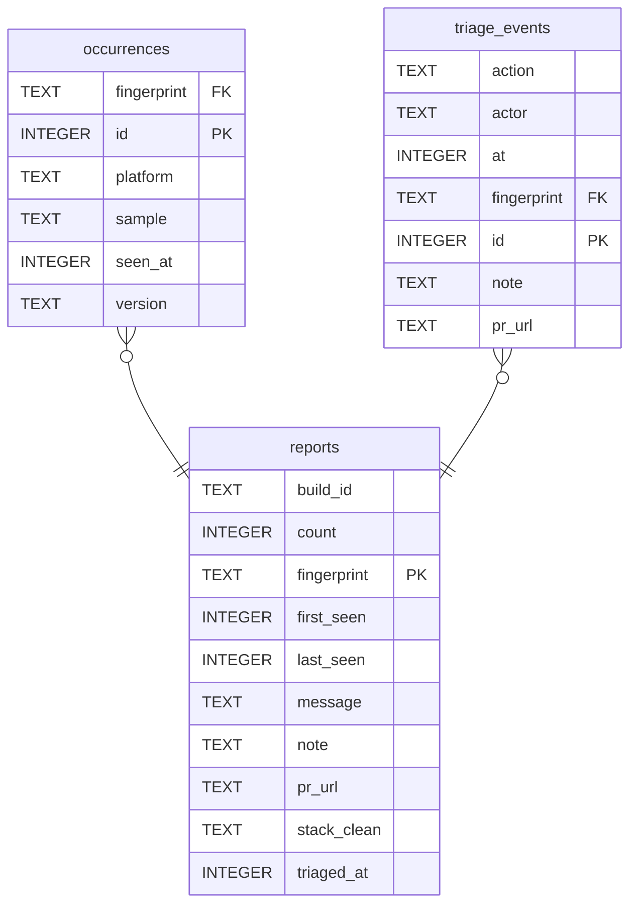

# delegator-report

Crash reporting for the ZingoLabs Delegator app (Zcash Crosslink featurenet).
A Cloudflare Worker with one D1 database. No third-party services.

The app posts crashes. Humans subscribe to an Atom feed. Agents poll a queue and mark
fingerprints triaged. Reports with the same stack on the same build collapse into one
fingerprint with a count.

**Production:** `https://delegator-report.dariovp01.workers.dev`

**API reference:** [`/_scalar`](https://delegator-report.dariovp01.workers.dev/_scalar), generated
from the route metadata. The raw spec is at `/_openapi.json`.

## Tokens

| token          | who holds it         | grants                                    |
| -------------- | -------------------- | ----------------------------------------- |
| `REPORT_TOKEN` | the app, as a header | `POST /report`, create or bump count only |
| `READ_TOKEN`   | feed readers, agents | list, feed, page, `/view`, `/queue`       |
| `WRITE_TOKEN`  | admins, agent runner | `POST /triage`                            |

The report token ships inside a public app, so it is a noise filter and a rotation handle, not
a secret. Reporter data (stacks, messages, breadcrumbs) is stored and shown but never trusted.
`/queue` strips the free-text fields and is the only shape meant for an agent.

## For the app

```sh
curl -X POST https://delegator-report.dariovp01.workers.dev/report \
  -H 'x-report-token: <REPORT_TOKEN>' -H 'content-type: application/json' \
  -d '{"buildId":"<short git sha>","version":"0.4.2","platform":"ios",
       "stack":"Error: boom\n  at foo (app.js:1:2)","message":"boom","breadcrumbs":["open wallet"]}'
```

Always `204`, even when the report is dropped. Do not await, retry, or show failures.

## For humans

Open `/?key=<READ_TOKEN>` for the list of all fingerprints. The page has a search bar, filters
(status, build, platform) and sortable columns (count, last seen). All of them are
query parameters, so a filtered view is a link you can bookmark. Each row links to a page with
the full report.

Subscribe a feed reader to `/feed.xml?key=<READ_TOKEN>` to get new crashes as they arrive. Each
entry links to the same report page. New crash types appear once. A recurring crash updates its
entry.

## For agents

`GET /queue?key=<READ_TOKEN>` returns untriaged fingerprints without free text.
`POST /triage?key=<WRITE_TOKEN>` records who looked at one and the PR that fixes it.
The `crash-triage` CLI in the delegator repo wraps both.

## Operations

Merging to `main` deploys through GitHub Actions (`.github/workflows/ci.yml`). Every PR runs
`pnpm check` and `pnpm build` first. The workflow needs two repository secrets:
`CLOUDFLARE_API_TOKEN` (Workers Scripts: Edit, D1: Edit) and `CLOUDFLARE_ACCOUNT_ID`.

```sh
pnpm wrangler tail          # live logs
pnpm wrangler rollback      # previous version
pnpm release                # manual deploy, only if CI is down
```

**Secrets** live in `.prod.vars` (gitignored) and go up with `pnpm secrets:push`. Keep a copy in
a password manager. To rotate one, change its line, push, then update the holders. Rotating
`READ_TOKEN` breaks every feed subscription URL.

**Schema changes.** `schema.sql` is the full schema for a fresh database. The deployed baseline
is `docs/schema/0001-20261031.sql`.

```sh
pnpm db:reset:local                    # apply schema.sql + seed locally
pnpm schema:snapshot <label>           # docs/schema/NNNN-...sql
pnpm schema:diff 1 2                   # the ALTER statements you need
# write migrations/NNNN-<label>.sql, then:
pnpm wrangler d1 execute delegator-report --remote --file=./migrations/NNNN-<label>.sql
pnpm erd                               # regenerate docs/erd.mmd and the diagram below, then merge the PR
```

Add columns nullable or with defaults so the old Worker keeps working between the migration
and the deploy. Production holds real user data. Never seed or reset it.



## Local development

```sh
pnpm install
cp .dev.vars.example .dev.vars     # dev tokens: dev-report-token, dev-token-change-me, dev-write-token
pnpm db:reset:local
pnpm dev                           # http://localhost:3000, API reference at /_scalar
```

`pnpm build && pnpm preview` runs the built Worker on workerd at port 8787, which is closer to
production than `pnpm dev`.

## New account setup

```sh
pnpm wrangler login
pnpm wrangler d1 create delegator-report     # paste database_id into wrangler.toml
pnpm db:init
printf 'REPORT_TOKEN=%s\nREAD_TOKEN=%s\nWRITE_TOKEN=%s\n' \
  "$(openssl rand -hex 32)" "$(openssl rand -hex 32)" "$(openssl rand -hex 32)" > .prod.vars
pnpm secrets:push
pnpm release
```
